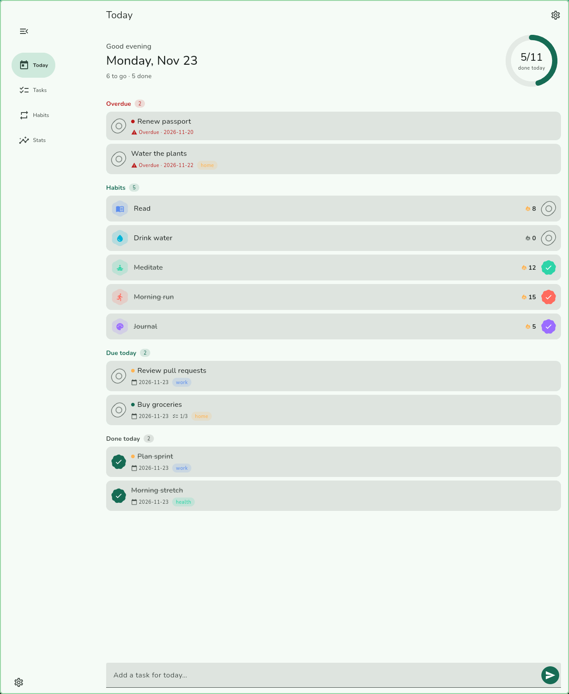
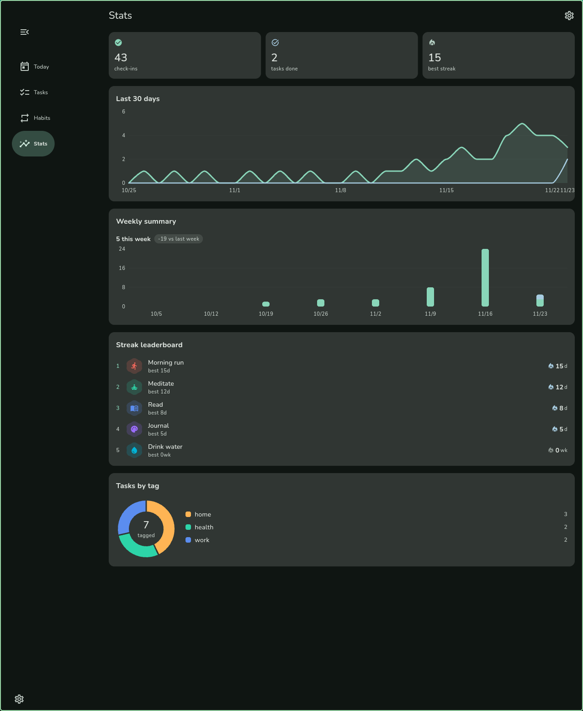

# NowPill

[](https://github.com/ibro-3/nowpill/actions/workflows/ci.yml)

A playful **Material 3 Expressive** habit tracker & to-do list. Local-first and
offline, with strict streaks, freeze tokens, recurring tasks, reminders, heatmaps,
and stats — wrapped in smooth, spring-driven motion.

Current release: **v0.10.0** (see `CHANGELOG.md`).

<p align="center">
  
  
</p>

## Features

- **Today dashboard** — greeting + spring progress ring in a card; overdue →
  habits due → tasks due → done-today; one FAB creates a task due today; an
  all-done celebration (ring overshoot, confetti).
- **To me** — a private, offline thought stream: send short notes to yourself,
  browse them grouped by day, and tap `http`/`https` links to open them in your
  browser. Local-first, included in backups and optional folder sync; no AI or
  account.
- **Search** — one reactive screen over tasks (titles, notes, subtasks), habits,
  tags, and personal chat notes; case- and accent-insensitive, tap-through to
  results.
- **Tasks** — subtasks, tags, priorities, due dates, recurring tasks
  (complete → spawn next occurrence), swipe-to-complete, filterable list.
- **Habits** — daily / weekdays / weekly-target schedules, curated icons & brand
  colors, **monthly and yearly heatmaps** (53×7 year grid alongside the month
  grid) with tap-backfill (≤30 days), streak odometer, freeze
  tokens (earned automatically, auto-consumed to bridge a missed day, refunded on
  backfill), **manual freeze mode** (opt-in per habit: choose when to spend a
  token), **measurable habits** (numeric daily goal; only 100% counts toward the
  streak, partial progress shown via a Today stepper), archive & delete from a
  dedicated **Archived habits** manager (restore or permanently delete).
- **Insights** — per-habit completion rate over 30 or 90 days, best weekday,
  and clean-day rate for quit habits; Stats adds habit-completion and
  routine-comparison rankings. Vacation-paused and frozen days are neutral.
- **Stats** — 30/90-day trend, weekly summary, streak leaderboard, tag donut.
- **Reminders** — exact alarms on Android (graceful inexact fallback), iOS, and
  Linux (in-app); **web reminders fire in-tab** with a permission + test-fire
  flow. Survive reboot via a boot receiver. **Done / Snooze actions** on the
  notification itself (Android background handler; iOS category sources ship).
- **Home-screen widgets** — today's progress + top streak on the launcher, a
  one-tap Check pill for the next undone habit, and a “Today's habits” list with
  per-habit check pills (Android AppWidget; check-ins work with the app closed;
  iOS WidgetKit/AppIntents sources included, build needs macOS).
- **Quit habits** — track what you're leaving behind without logging good days:
  pick a quit date, log relapses when they happen, and keep a "days clean"
  streak with a best-ever record. Relapses and the quit date sync and back up.
- **Routines** — group habits (Morning, Evening, …), filter the Habits tab,
  and choose which groups a vacation pauses.
- **Vacation mode** — plan date ranges in Settings and scope them to routines
  or individual habits. Paused days are neutral (no misses, no freeze spend,
  no fake streak growth), never notify, and collapse under a disclosure on
  Today.
- **First-run onboarding** — a short 3-step intro with optional starter habits
  (drink water, move, read); skip it any time, all choices editable later.
- **Task lists** — group tasks into lists (projects) with per-list filters and
  inline create/rename/delete; deleting a list never deletes its tasks. Lists
  travel with folder sync and backups (schema v5).
- **Weekly review** — a Stats card recapping last week's check-ins, tasks,
  comparison to the week before, best streak, habits at risk, and tasks due in
  the week ahead.
- **Accessibility** — screen-reader labels on heatmap days, progress ring,
  streak/token widgets, and charts; tap-target and 2× text-scale regression
  tests for the primary tabs.
- **Backup & sync** — versioned JSON export/import (schema v7, imports v1–v6)
  with a confirm-replace-all flow; **automatic daily backups** (last 7 kept,
  explicit restore); **optional folder sync** through a user-chosen folder
  (Syncthing/Dropbox/iCloud Drive transport; per-device envelope files, LWW
  merge with tombstones — no server, no account; on Chromium web through the
  File System Access API with the folder handle kept in IndexedDB).
- **Languages** — English and Spanish, switchable live in Settings.
- **Design** — Material 3 Expressive (`material_3_expressive` + `motor` +
  `material_new_shapes`), Nunito emphasized type scale, Material You dynamic
  color, spring-driven shape morphs on completion/selection, a slowly drifting
  and morphing ambient backdrop behind all tabs, spring-animated progress
  fills, and a reduce-motion mode (honors the OS accessibility setting).

## Platforms

Android · iOS · Web · Linux desktop

## Download

Prebuilt assets for the latest release are on the
[Releases page](https://github.com/ibro-3/nowpill/releases/latest):

| Asset | Use |
| --- | --- |
| `nowpill-<version>-universal.apk` | Any Android device (one file, largest) |
| `nowpill-<version>-arm64-v8a.apk` | Modern 64-bit Android |
| `nowpill-<version>-armeabi-v7a.apk` | Older 32-bit Android |
| `nowpill-<version>-linux-x64.tar.gz` | Linux desktop, x86-64 |

**Android** — enable *Install unknown apps* for your file manager/browser, or
run `adb install -r nowpill-<version>-arm64-v8a.apk`. Every APK is signed with
the NowPill upload key (`CN=NowPill`), certificate SHA-256:

```
1F:1E:61:6F:19:38:39:EB:B4:4A:C0:63:97:FA:56:69:94:94:14:32:C1:44:64:8F:BC:76:A5:F5:B3:35:7E:01
```

Check it with `apksigner verify --print-certs nowpill-<version>-universal.apk`.
Pick one variant and keep using it: split APKs carry a higher internal version
code than the universal one, so switching variants requires uninstalling first.

**Linux** — extract and run the bundled executable:

```bash
tar -xzf nowpill-<version>-linux-x64.tar.gz
cd nowpill-<version>-linux-x64
./nowpill
```

Requires x86-64 Linux with GTK 3; the tarball is built on GitHub's Ubuntu runner
for a broad glibc baseline.

Each release includes a `SHA256SUMS` file covering all published assets — run
`sha256sum -c SHA256SUMS` next to the downloads to verify them.

## Requirements

- Flutter 3.50+ / Dart 3.14+ (uses the standalone `material_ui` package)
- Android SDK for Android builds; Xcode/macOS for iOS builds
- Linux: clang, cmake, ninja, GTK3 headers
- A Chromium-based browser for web runs, e.g.
  `export CHROME_EXECUTABLE=/usr/bin/helium-browser`

## Run

```bash
flutter pub get
dart run build_runner build   # generated code is gitignored
flutter gen-l10n              # l10n classes are gitignored (pub get also runs it)

flutter run -d linux          # Linux desktop
flutter run -d chrome         # Web (Chromium-based browser)
flutter run -d android        # Android device or emulator
```

## Test & quality gates

```bash
flutter analyze
dart format --output=none --set-exit-if-changed lib test integration_test test_driver
flutter test                              # unit + widget tests
flutter test integration_test -d linux    # end-to-end flows + frame budgets

# Android emulator (perf suite needs --no-dds):
flutter drive --no-dds --driver=test_driver/integration_test.dart \
  --target=integration_test/perf_test.dart -d <emulator-id>
```

CI (`.github/workflows/ci.yml`) runs analyze → format → build_runner → tests,
then builds web + APK and runs the Linux integration tests headless.

Generated code (`*.g.dart`, `*.freezed.dart`, `*.drift.dart`) is gitignored;
regenerate with `dart run build_runner build`.

## Build

```bash
flutter build apk --release
flutter build appbundle --release   # Play Store upload (signed AAB)
flutter build web --release
flutter build linux --release
# iOS: flutter build ipa  (requires macOS + signing)
```

**Android release signing:** copy `android/key.properties.example` to
`android/key.properties` and point it at your upload keystore (both are
gitignored). Without it, release builds fall back to debug signing so CI and
`flutter run --release` keep working.

## Architecture

```
lib/
  core/       theme (M3E tokens, Nunito, dynamic color), motion (AppMotion,
              MotionScope, shared shape-morph and press springs), router
              (go_router StatefulShellRoute), settings
  domain/     pure Dart engines: streak replay, recurrence, schedules,
              reminder planner, stats, sync merge — all unit-tested, no
              Flutter imports
  data/       Drift/SQLite db + DAOs, repositories, export/backup, auto-backup,
              notifications (incl. background action handler), folder sync,
              widget (today-summary snapshot bridge for home-screen widgets)
  features/   today / tasks / habits / stats / chat / search / settings / shell
```

Local-first: all data lives in Drift/SQLite. Streaks and freeze tokens are
*derived* by replaying check-in history (no mutable counters), so backfilling a
past day automatically refunds any freeze it would have consumed.

## Notes

- App ID is `app.nowpill` (Android, iOS, Linux).
- Data is stored locally. Optional folder sync (Android, desktop, and Chromium
  web) keeps devices in step through a folder you choose — no server. A hosted
  sync service is not offered.
- Store submission materials live in `store/` (listing copy, privacy policy +
  Play data-safety answers, phone screenshots).
- The iOS home-screen widget ships as WidgetKit sources + integration steps in
  `ios/NowPillWidget/` — adding the extension target requires Xcode on macOS.
- See `doc/m3e_spike_decision.md` (design-system adoption), `doc/motion_audit.md`
  (motion polish pass), and `doc/screenshots/` (visual pass).
